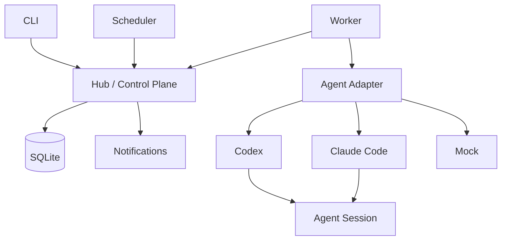

# TaskCircuit

A durable local runtime for autonomous CLI agents.

TaskCircuit turns one-shot CLI agents such as Codex and Claude Code into persistent work that can pause, resume, retry, wait for human input, schedule future execution, and continue across process restarts.

## Why TaskCircuit

CLI agents usually run a command and exit. Longer work needs durable state, session resume, human interaction, retry, scheduling, recovery, and a way to observe progress. TaskCircuit provides the local runtime and orchestration for that work; it is not a model training, reasoning, or prompt framework.

## What it does

V0.1 provides durable work items, executions, agent sessions and interactions; Codex and Claude Code adapters; ask, answer and resume; retry, later and cron scheduling; a runtime change feed, SSE, inbox and local notifications; and a Windows background launcher, Task Scheduler integration, Job Object, doctor and background logs. A mock adapter is included for the walkthrough below.

## Architecture



On Windows, Task Scheduler starts the Runtime Launcher, which supervises the Hub and Worker within a Job Object. See [architecture](docs/architecture.md) and [Windows runtime](docs/windows-runtime.md).

## Core model

A Work Item represents continuing work and can contain multiple Executions. An Execution is one attempt or continuation. Multiple Executions can resume the same Agent Session. An Interaction records a question and its human answer; an answer creates a continuation rather than leaving an agent process waiting.

## Quick start

Install Node.js 24 or later. From the project directory, start the Hub in one terminal:

```powershell
npm ci
npm run build
npm exec -- taskcircuit hub
```

In a second terminal in the same directory:

```powershell
npm exec -- taskcircuit worker
```

In a third terminal, use the included mock adapter; no agent account is needed:

```powershell
npm exec -- taskcircuit emit demo.mock.color
npm exec -- taskcircuit inbox
```

Wait for the question, copy its interaction ID from the inbox, then replace the placeholder below:

```powershell
npm exec -- taskcircuit answer "<interaction-id>" 蓝色
npm exec -- taskcircuit status
npm exec -- taskcircuit work "<work-item-id>"
```

The worker resumes the work and completes it. Copy the work item ID from `status`. Stop the Hub and Worker with Ctrl+C. State persists in the user's TaskCircuit home; the default is `~/.taskcircuit`.

## Codex and Claude Code

Install and authenticate the desired CLI yourself. The included configuration routes `demo.codex.color` and `demo.claude.color` to the corresponding agent; emit either event and use the same inbox and answer steps. Calls may consume provider quota. See [agent adapters](docs/agents.md).

## Scheduling

Later and retry create durable schedules for work. User schedules can emit events once or on a five-field cron expression with a time zone. For example:

```powershell
npm exec -- taskcircuit schedule add --cron "0 9 * * *" --timezone Asia/Shanghai --event demo.cron
npm exec -- taskcircuit schedule list
```

Missed cron occurrences use a single catch-up firing. See [scheduling](docs/scheduling.md).

## Human-in-the-loop

An agent can return an ask result; TaskCircuit stores the interaction and ends that execution. Use `inbox` and `answer` to supply input, after which the worker can resume the same session.

## Realtime and notifications

The Hub exposes a replayable runtime change feed over SSE, an inbox and notifications. `taskcircuit watch` displays changes. The included local notification channel is described in [notifications](docs/notifications.md); stream retention and cursor behavior are documented in [realtime](docs/realtime.md).

## Windows background runtime

From the project directory, after building:

```powershell
npm exec -- taskcircuit runtime install
npm exec -- taskcircuit runtime start
npm exec -- taskcircuit runtime status
npm exec -- taskcircuit runtime stop
npm exec -- taskcircuit runtime uninstall
```

Uninstall preserves TaskCircuit user data. The Windows At-Logon Task definition was inspected and manually started successfully. An actual Windows reboot/logon cycle was not performed during V0.1 validation. Windows startup integration was verified without destructive reboot/logoff testing.

## Security model

V0.1 uses a Trusted Local execution model. Codex and Claude Code are installed by the user and run as that user. TaskCircuit does not intentionally expose control-plane database paths, internal state, or runtime secrets to agents. It does not provide OS-level filesystem isolation against a malicious process running as the same user. The Hub listens on loopback and does not provide public API authentication. Job Objects manage process lifetime, not security isolation. See [security model](docs/security-model.md).

## CLI

- `taskcircuit hub`, `worker`, `emit`, `work`, `status`, `inbox`, `answer`, `watch`
- `taskcircuit schedule list/add/pause/resume/cancel`
- `taskcircuit runtime install/start/stop/restart/status/uninstall`
- `taskcircuit doctor`, `taskcircuit --version`

When running from this checkout without a global install, prefix commands with `npm exec --`. Use `taskcircuit --help`, `taskcircuit schedule --help`, and `taskcircuit runtime --help` for usage.

## Development

```powershell
npm ci
npm run typecheck
npm run format:check
npm test
npm audit
```

Real-agent E2E tests are manual and require locally installed, authenticated CLIs. The Windows runtime E2E creates and cleans up an isolated test task. See [release checklist](docs/release-checklist.md).

## Roadmap

V0.1 is feature frozen. Execution isolation, a desktop control plane, external channels and sources, and remote or multi-user operation are future work; see [roadmap](docs/roadmap.md). Version labels there are tentative.

## Limitations

- Trusted Local, not OS sandbox isolation.
- The background runtime integration currently targets Windows.
- No desktop UI, remote workers, multi-user operation, or RBAC.
- An actual reboot/logon cycle was not part of automated validation.

## License

TaskCircuit is licensed under the [MIT License](LICENSE).
