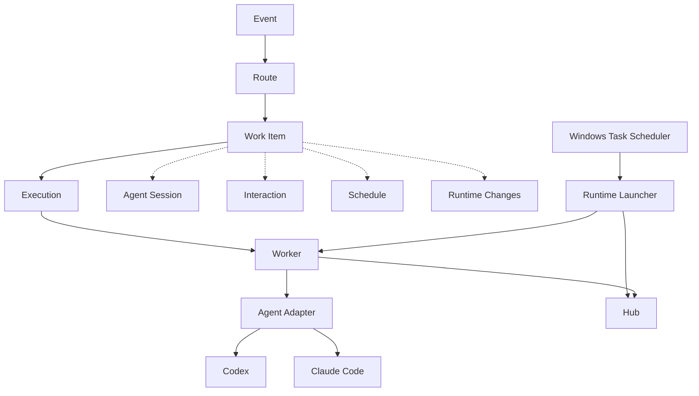

# TaskCircuit

**English** | [简体中文](./README.zh-CN.md)

A durable local runtime for autonomous CLI agents.

> One task. Many executions. One durable lifecycle.

### What's new in v0.1.1

- Human-readable output for `status`, `work`, `inbox`, `runtime status`, and `doctor`, with `--json` for scripts.
- More specific Codex / Claude error classification and retry decisions.
- Windows background runtime startup without a persistent console window.

## Why TaskCircuit?

A CLI agent usually runs for one process or session. TaskCircuit keeps a task's state across runs so that work can continue after an agent exits or the runtime restarts. It handles orchestration around Codex and Claude Code rather than replacing their reasoning.

- Accept configured events and create durable Work Items automatically.
- Run multiple Executions for a Work Item and resume an Agent Session when available.
- Ask → exit → answer → resume, without a process waiting for a human.
- Continue with Later, Retry, or Cron; recover persisted work after restart.
- Observe runtime changes over SSE and deliver durable notifications.
- Run Hub and Worker in the background on Windows.

A task can also fail, exhaust its retry policy, or be cancelled; completion is not guaranteed.

## How It Works

```text
Event → Route → Work Item → Execution → Worker → Agent Adapter → Codex / Claude Code
```



The diagram shows relationships and the Windows process arrangement; Hub persists and coordinates state in SQLite. See [architecture](docs/architecture.md).

## Core Concepts

### Work Item

A long-lived task created by routing an event. **A Work Item is not an Execution**: one task may have several Executions while remaining the same Work Item.

### Execution

A concrete run or attempt within a Work Item. Answering, Later, and Retry can create a new Execution.

### Agent Session

The persisted association with an external Codex or Claude Code conversation. Subsequent Executions can resume the same session when one has been established.

### Interaction

A persisted human question and answer. An ask ends the current execution; answering schedules a continuation.

### Schedule

A durable trigger for a user-defined once or Cron event, or a Work Item continuation due to Later or Retry.

### Runtime Change

A persisted, observable state transition in the change feed; it is distinct from an Interaction or Notification.

### Notification

A notice about an event requiring attention, with a Delivery record for a configured Channel. The included channel is local console; Inbox lists open Interactions.

## Quick Start

Use Node.js 24 or later. From the project directory, install and build:

```powershell
npm ci
npm run build
npm link
taskcircuit --version
taskcircuit doctor
```

`npm link` creates a global command for this user environment. Alternatively, omit it and prefix each command with `npm exec --` from the project directory.

On Windows, install and start the background runtime:

```powershell
taskcircuit runtime install
taskcircuit runtime start
taskcircuit runtime status
```

Alternatively, run `taskcircuit hub` and `taskcircuit worker` in separate terminals from the project directory. Use this foreground option on other platforms. Do not run both options against the same port.

Try the included Mock adapter without Codex or Claude credentials:

```powershell
taskcircuit emit demo.color
taskcircuit inbox
```

Wait for the question and copy its interaction ID from the inbox. Replace the placeholder with that ID; the included Mock choices are `蓝色` and `绿色`:

```powershell
taskcircuit answer "<interaction-id>" 蓝色
taskcircuit status
taskcircuit work "<work-item-id>"
```

Copy the work item ID from `status`; the Worker resumes the task and completes the demo. The default data home is `~/.taskcircuit`; `TASKCIRCUIT_HOME` overrides it. Stop foreground processes with Ctrl+C, or use `taskcircuit runtime stop` for the Windows background runtime.

## Agent Support

The current adapters support OpenAI Codex CLI and Anthropic Claude Code, plus Mock for local demonstrations. Install and authenticate each real CLI yourself. The included routes `demo.codex.color` and `demo.claude.color` use those adapters. Real runs may consume provider quota. The Adapter boundary allows future integrations; they are not included in V0.1. See [agent adapters](docs/agents.md).

## Scheduling and Continuation

A user Cron schedule follows `Schedule → Event → Route → Work Item → Execution`. A Later result or an eligible Retry schedules a new Execution instead of keeping the old process waiting; an answered Interaction also creates a continuation. Existing sessions can be reused. Missed Cron occurrences use one catch-up firing. See [scheduling](docs/scheduling.md).

```powershell
taskcircuit schedule add --cron "0 9 * * *" --timezone Asia/Shanghai --event demo.cron
taskcircuit schedule list
```

## Realtime and Notifications

Runtime Changes are exposed through an SSE stream; `taskcircuit watch` observes them. Notifications have Delivery records for Channels, while an Interaction is the actual human question and answer. The current built-in Channel is local console, and `taskcircuit inbox` lists open Interactions. See [realtime](docs/realtime.md) and [notifications](docs/notifications.md).

## Windows Runtime

Windows Task Scheduler starts the Runtime Launcher, which supervises Hub and Worker inside a Windows Job Object. The Job Object contains process lifetimes; it is not a filesystem security sandbox.

```powershell
taskcircuit runtime install
taskcircuit runtime start
taskcircuit runtime stop
taskcircuit runtime restart
taskcircuit runtime status
taskcircuit runtime uninstall
```

Uninstall preserves TaskCircuit user data. The At-Logon task definition was inspected and manually started successfully. An actual Windows reboot/logon cycle was not performed during V0.1 validation. See [Windows runtime](docs/windows-runtime.md).

## Security Model

V0.1 uses **Trusted Local**: Codex and Claude Code are installed and run under the same OS user identity as TaskCircuit. TaskCircuit does not intentionally expose control-plane database paths, internal state, or runtime secrets to agents, but it does not provide OS-level filesystem isolation against a malicious process under that same identity. Hub listens on loopback without public API authentication. Sandboxed execution is planned, not implemented. See [security model](docs/security-model.md).

## Architecture

The Control Plane contains CLI, Hub, Scheduler, notification dispatcher, and SQLite. Worker fetches work from Hub and invokes the Agent Adapter. See [architecture and trust boundaries](docs/architecture.md).

The `status`, `work <id>`, `inbox`, `runtime status`, and `doctor` commands use human-readable output by default. Add `--json` for machine-readable output; Work Item and Interaction IDs remain complete. External session IDs remain redacted. Agent failures distinguish quota, rate limits, authentication, availability, timeouts, protocol errors, and other failures; see [agent adapters](docs/agents.md).

## Development

```powershell
npm ci
npm run build
npm run typecheck
npm run format:check
npm test
npm audit
```

The [GitHub Actions configuration](.github/workflows/ci.yml) runs basic CI on Ubuntu and Windows with Node 24. Real Codex and Claude E2E tests are manual and need locally installed, authenticated CLIs; they do not run in CI. See the [release checklist](docs/release-checklist.md).

## Roadmap

**Current:** V0.1 local durable runtime as described above.

**Planned:** execution isolation; a desktop control plane; external sources and notification channels; and, later, remote workers, multi-user operation, RBAC, and cloud runtime. Scope and version labels are tentative. See [roadmap](docs/roadmap.md).

## Limitations

- Trusted Local is not an OS sandbox; no multi-user or RBAC support.
- Background runtime integration currently targets Windows; no desktop UI or remote workers.
- An actual Windows reboot/logon cycle was not part of V0.1 validation.

## License

[MIT License](LICENSE). Copyright (c) 2026 MerLin.
