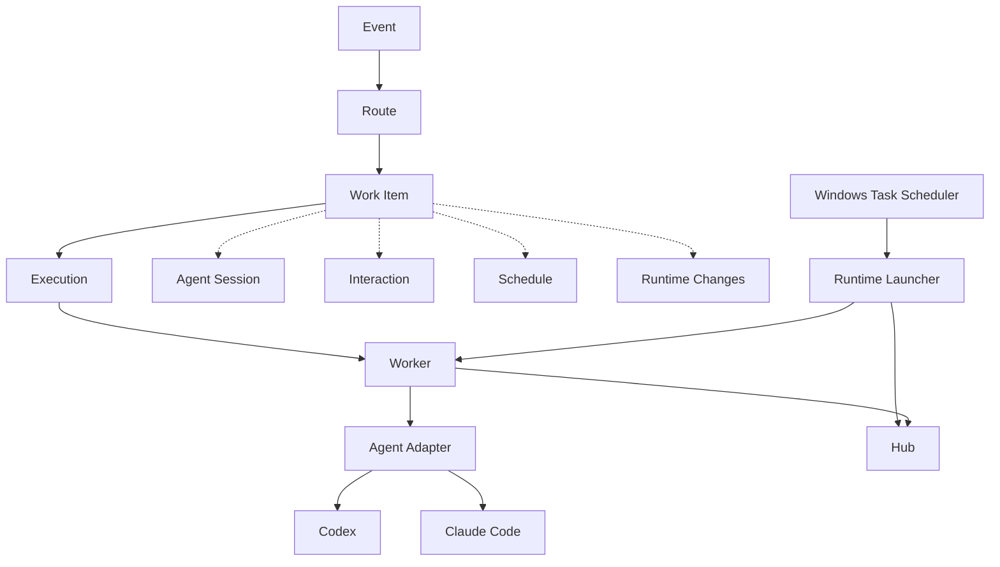

# TaskCircuit

[English](./README.md) | **简体中文**

TaskCircuit 是一个面向 Codex、Claude Code 等 CLI Agent 的本地持久化任务运行时。

> 一个任务，多次执行，同一生命周期，直到真正完成。

### v0.1.1 更新

- `status`、`work`、`inbox`、`runtime status` 和 `doctor` 默认提供人类可读输出，并支持 `--json`。
- 改进 Codex / Claude 错误分类和重试判断。
- 修复 Windows 后台运行时常驻黑色控制台窗口的问题。

## 为什么需要 TaskCircuit？

普通 CLI Agent 往往围绕一次进程或会话工作。TaskCircuit 在 Agent 之上管理持久化任务生命周期：配置的事件到来后，经路由创建 Work Item（长期任务），再通过一个或多个 Execution（执行）驱动 Agent。当 Agent 提问、延迟继续或需要重试时，当前进程可以退出；任务状态、Agent Session（Agent 会话）、Interaction（人工交互）和 Schedule（调度）由运行时保存，条件满足后可以创建新的 Execution 并在已有会话时恢复该会话。

TaskCircuit 负责本地任务编排，不替代 Codex 或 Claude Code 的推理能力。它支持：

- 根据配置自动接收事件并创建持久 Work Item。
- 为同一 Work Item 运行多次 Execution，并在可用时恢复 Agent Session。
- 提问 → 退出 → 人工回答 → 续接，无需进程等待人。
- Later、Retry、Cron 与进程重启后的持久化恢复。
- 通过 SSE 观察运行时变化，并持久化通知和投递状态。
- 在 Windows 后台运行 Hub 和 Worker。

任务也可能失败、耗尽重试次数或被取消，不能保证每次都完成。

## 工作原理

```text
Event → Route → Work Item → Execution → Worker → Agent Adapter → Codex / Claude Code
```



图中展示对象关系和 Windows 进程组织方式；Hub 使用 SQLite 持久化并协调状态。详见[架构文档](docs/architecture.md)。

## 核心概念

### Work Item（长期任务）

经事件路由创建的长期任务。**Work Item 不等于 Execution**：同一任务可以经历多次 Execution，仍然是同一个 Work Item。

### Execution（执行）

Work Item 中的一次具体运行或尝试。人工回答、Later 和 Retry 可以创建新的 Execution。

### Agent Session（Agent 会话）

与外部 Codex 或 Claude Code 对话的持久关联。如果已经建立会话，后续 Execution 可以恢复同一会话。

### Interaction（人工交互）

持久保存的人工问题及回答。Agent 提问后结束当前执行；回答会安排后续执行。

### Schedule（调度）

持久触发条件：可以是用户创建的一次性或 Cron 事件，也可以是 Later 或 Retry 产生的任务续接。

### Runtime Change（运行时变化）

变化流中持久保存、可观察的状态变更，与 Interaction 和 Notification 不是同一个概念。

### Notification（通知）

提醒用户关注事项的通知，并通过 Delivery（投递记录）记录向配置的 Channel（通道）投递。内置通道为本地控制台；Inbox 列出待回答的 Interaction。

## 快速开始

需要 Node.js 24 或更高版本。在项目目录安装并构建：

```powershell
npm ci
npm run build
npm link
taskcircuit --version
taskcircuit doctor
```

`npm link` 会在当前用户环境创建全局命令。也可以跳过它，在项目目录执行时为每条命令加上 `npm exec --` 前缀。

Windows 下可以安装并启动后台运行时：

```powershell
taskcircuit runtime install
taskcircuit runtime start
taskcircuit runtime status
```

也可以在项目目录的两个终端中分别运行 `taskcircuit hub` 和 `taskcircuit worker`；其他平台使用这种前台方式。不要让前台和后台运行时同时占用同一端口。

使用内置 Mock 适配器演示，无需 Codex 或 Claude 凭据：

```powershell
taskcircuit emit demo.color
taskcircuit inbox
```

等待问题出现，从 Inbox 复制 Interaction ID，替换下面的占位符。内置 Mock 的选项是 `蓝色` 和 `绿色`：

```powershell
taskcircuit answer "<interaction-id>" 蓝色
taskcircuit status
taskcircuit work "<work-item-id>"
```

从 `status` 复制 Work Item ID；Worker 会续接任务并完成演示。默认数据目录为 `~/.taskcircuit`，可通过 `TASKCIRCUIT_HOME` 覆盖。前台进程用 Ctrl+C 停止；Windows 后台运行时用 `taskcircuit runtime stop` 停止。

## Agent 支持

当前适配器支持 OpenAI Codex CLI 和 Anthropic Claude Code，并提供用于本地演示的 Mock。真实 CLI 需要用户自行安装和登录；内置 `demo.codex.color`、`demo.claude.color` 路由可分别使用它们。真实运行可能消耗服务额度。Agent Adapter（Agent 适配器）边界允许以后扩展，但其他集成不属于 V0.1。详见 [Agent 适配器](docs/agents.md)。

## 调度与任务续接

用户 Cron 计划按 `Schedule → Event → Route → Work Item → Execution` 触发。Later 或符合策略的 Retry 会安排新的 Execution，不让旧进程一直等待；人工回答也会创建续接。已有会话可以复用。停机期间错过的 Cron 按一次补触发处理。详见[持久化调度](docs/scheduling.md)。

```powershell
taskcircuit schedule add --cron "0 9 * * *" --timezone Asia/Shanghai --event demo.cron
taskcircuit schedule list
```

## 实时状态与通知

Runtime Change 通过 SSE 流对外提供，`taskcircuit watch` 可以观察变化。Notification 的投递状态由 Delivery 记录，Interaction 则保存实际的人机问答。当前内置 Channel 为本地控制台，`taskcircuit inbox` 列出待回答的 Interaction。详见[实时变化](docs/realtime.md)和[通知](docs/notifications.md)。

## Windows 后台运行

Windows Task Scheduler 启动 Runtime Launcher，后者在 Windows Job Object 中监督 Hub 和 Worker。Job Object 用于约束进程生命周期，不是文件系统安全沙箱。

```powershell
taskcircuit runtime install
taskcircuit runtime start
taskcircuit runtime stop
taskcircuit runtime restart
taskcircuit runtime status
taskcircuit runtime uninstall
```

卸载保留 TaskCircuit 用户数据。已检查 At-Logon 任务定义并成功手动启动；V0.1 验证没有执行实际 Windows 重启和登录周期。详见 [Windows 运行时](docs/windows-runtime.md)。

## 安全模型

V0.1 使用 **Trusted Local（本地可信执行边界）**：Codex 和 Claude Code 由用户安装，并以与 TaskCircuit 相同的操作系统用户身份运行。TaskCircuit 不主动向 Agent 提供控制面数据库路径、内部状态或运行时秘密，但不提供针对同用户恶意进程的 OS 级文件系统隔离。Hub 监听回环地址，不提供公网 API 认证。沙箱执行是计划中的能力，尚未实现。详见[安全模型](docs/security-model.md)。

## 系统架构

Control Plane（控制面）包括 CLI、Hub、Scheduler、通知分发器和 SQLite。Worker 从 Hub 获取工作并调用 Agent Adapter。详见[架构与信任边界](docs/architecture.md)。

`status`、`work <id>`、`inbox`、`runtime status` 和 `doctor` 默认以人类可读形式显示；加 `--json` 可获取机器可读输出，Work Item 和 Interaction ID 保持完整。外部会话 ID 仍然隐藏。Agent 错误可区分额度、限流、认证、CLI 不可用、超时、协议及其他失败；详见 [Agent 适配器](docs/agents.md)。

## 开发

```powershell
npm ci
npm run build
npm run typecheck
npm run format:check
npm test
npm audit
```

[GitHub Actions 配置](.github/workflows/ci.yml)在 Ubuntu、Windows 和 Node 24 上运行基础 CI。真实 Codex 和 Claude E2E 需要本地安装并登录 CLI，只能手动执行，不在 CI 中运行。详见[发布检查表](docs/release-checklist.md)。

## 路线图

**当前：**上文所述的 V0.1 本地持久化运行时。

**计划中：**执行隔离、桌面控制面、外部来源和通知通道；更远期包括远程 Worker、多用户、RBAC 和云运行时。范围和版本编号均暂定。详见[路线图](docs/roadmap.md)。

## 限制

- Trusted Local 不是 OS 沙箱；不支持多用户和 RBAC。
- 后台运行时集成目前面向 Windows；没有桌面 UI 和远程 Worker。
- V0.1 验证没有执行实际 Windows 重启和登录周期。

## 许可证

[MIT License](LICENSE)。Copyright (c) 2026 MerLin。
