# TaskCircuit 目标架构

> 设计草案：下述新接口、表与行为均尚未实现。兼容基线为 v0.1.1；安全和隔离能力必须分别验证。本提案不授权运行外部操作，也不改变当前 API。

## 1. 总体与边界

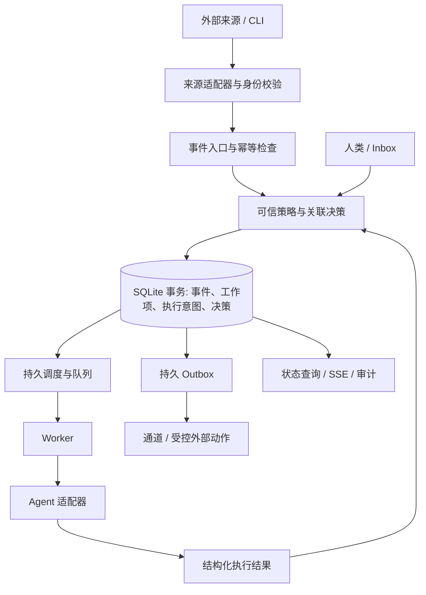

信任边界：外部事件及 Agent 输出都是不可信数据；来源认证只证明来源身份，不证明内容安全。可信策略和授权配置由本地管理员控制，不能由事件覆盖。Worker、Agent 及插件默认以用户身份运行；没有 OS 强制隔离时，同用户进程仍能读取或修改本地文件，组件间接口也不能提供强安全边界。

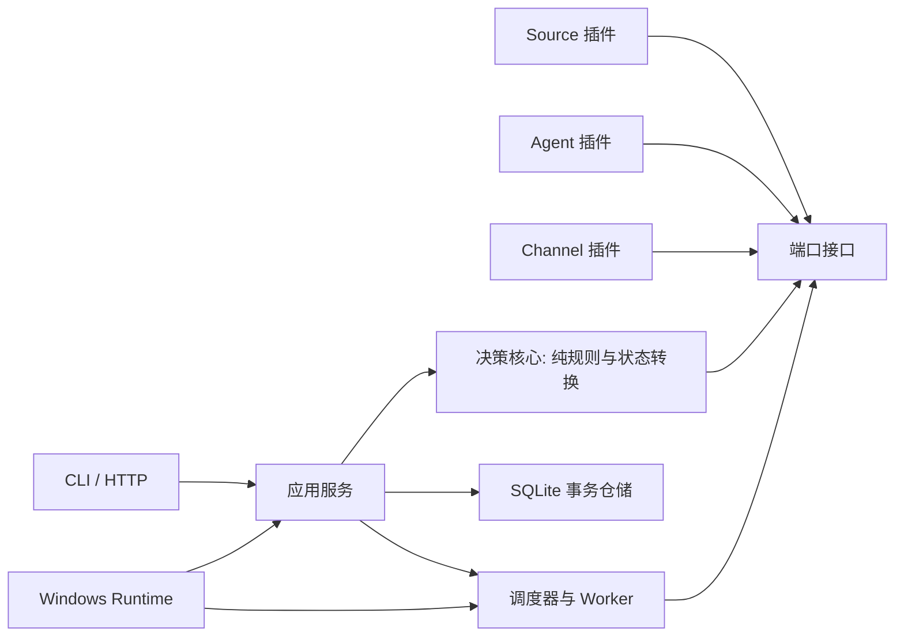

箭头表示依赖方向，核心只依赖接口和数据类型；平台启动器负责进程生命周期，不负责业务授权。IO、时钟、随机标识、策略快照从外壳注入；相同输入与快照应产生相同决策。新架构不要求立刻迁移成独立进程。

## 2. 数据模型

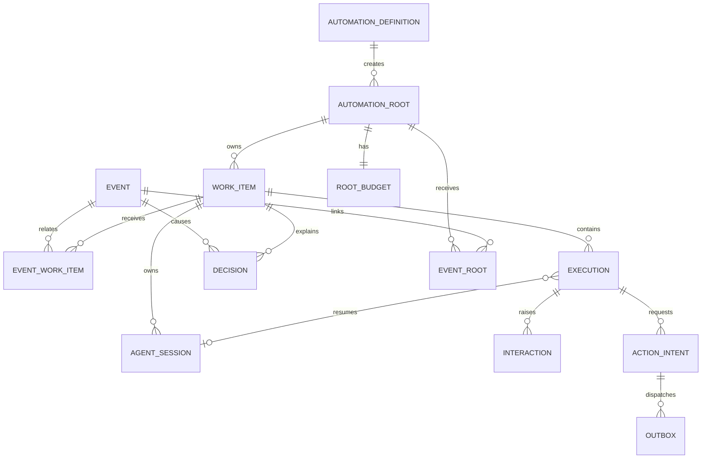

当前实现每个工作项至多一个 session；图中多个 session 是未来演进，并不表示当前支持。建议增加或逐步引入：

| 对象                  | 主要字段与约束                                                                                                                            |
| --------------------- | ----------------------------------------------------------------------------------------------------------------------------------------- |
| Event                 | id、source_instance、delivery_id、payload_hash、type、received_at、parent_event、root_id；来源实例和 delivery_id 唯一；正文按保留策略存储 |
| EventWorkItem         | event_id、work_item_id、关联原因与规则快照；多对多有联合唯一约束，仅限事件已关联到该工作项所属 Root                                       |
| WorkItem              | id、可信业务关联键、状态、版本、创建与更新时间、当前预算根；关联键作用域和冲突策略由可信配置确定                                          |
| Execution             | id、work_item_id、序号、状态、attempt、lease_token、lease_until、policy_version、session_id、结果摘要；领取和提交使用比较更新             |
| AgentSession          | adapter、外部会话标识、恢复状态；避免在普通日志泄漏标识或凭据                                                                             |
| Decision              | 输入 ID、规则版本、关联键来源、动作、原因、时间、使用的预算快照及来源权限；敏感正文不必进入日志                                           |
| Interaction           | work_item_id、execution_id、状态、可回答主体、到期时间、revision、answer_id；审批另绑定动作和计划摘要                                     |
| ActionIntent / Outbox | 唯一动作键、目标、请求摘要、状态、attempt、外部回执；外部成功但回执缺失时可标为 unknown                                                   |
| RootBudget            | 根任务共享的次数、深度、截止时间、调用量或费用上限、已用与预留；只允许受控管理动作调整                                                    |

增加可追溯记录不意味着现有 `runtime_changes` 就可重放；旧数据保留为现有业务表事实，对缺失的历史决策标为“不可用”，不虚构。数据库改动必须有可回滚备份与升级测试，现有 1–4 迁移和会话数据需兼容；是否引入完整事件溯源另行评审。

## 3. 事件入口、关联和去重

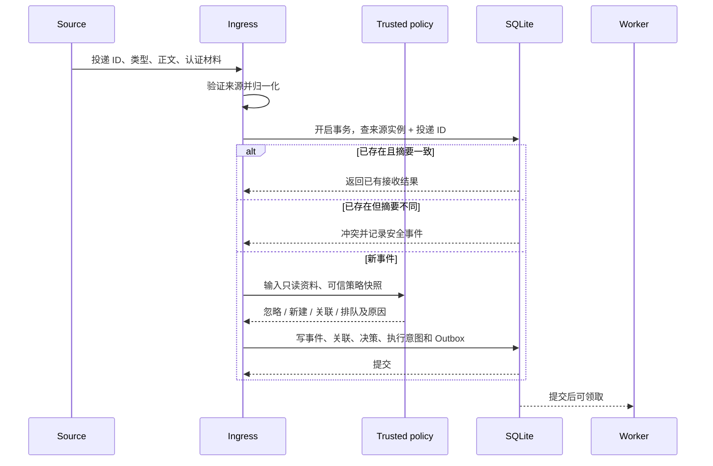

来源适配器必须返回由入口基于可信注册信息绑定的来源身份；不得接受外部正文自报的权限或 trustLevel。可信解析器可以从数据中提取候选业务标识，但规则限定格式、作用域与权限；同名对象跨来源不能自然合并。没有可靠投递 ID 时由来源适配器定义稳定键及其碰撞规则；不能以随意生成的 ID 声称防重。

幂等处理投递重放，归并处理不同事件。归并策略限定规则、来源作用域和业务键：已完成项是否重开须明确配置；执行中收到的新事件进入下一批，不能改写运行中的输入快照；等待审批时如果相关计划改变，旧审批失效。事务唯一约束和版本比较覆盖并发入口；外部回调不能在数据库事务中调用。

## 4. Agent 回执与有限反馈

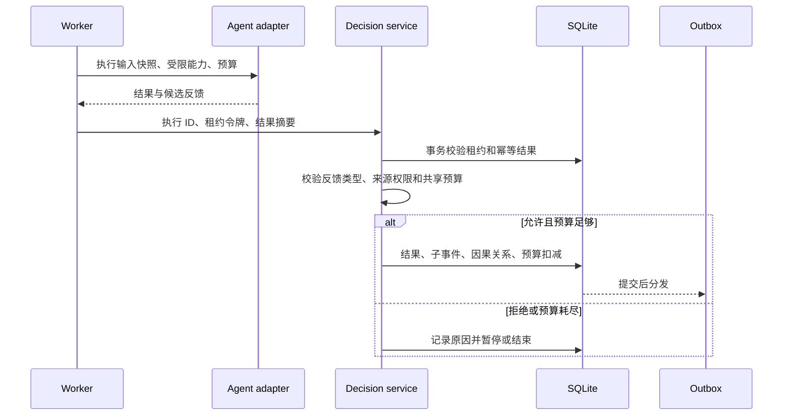

候选反馈是数据，不直接执行；策略决定可产生的类型和目标。子事件继承根 ID、父事件、策略快照和预算账本，不能由 Agent 重置。建议上限包括最大反馈深度、执行次数、deadline、Agent 调用/令牌和费用；父级与系统上限取更严格值，重试也计入次数。可计量成本先预留再结算；当外部提供商没有可靠用量或结果丢失时，无法保证精确费用上限，硬上限应暂停并待核实，而不是假装无消耗。人工继续也必须具备相应权限，调整预算留痕。

## 5. 人工交互与审批

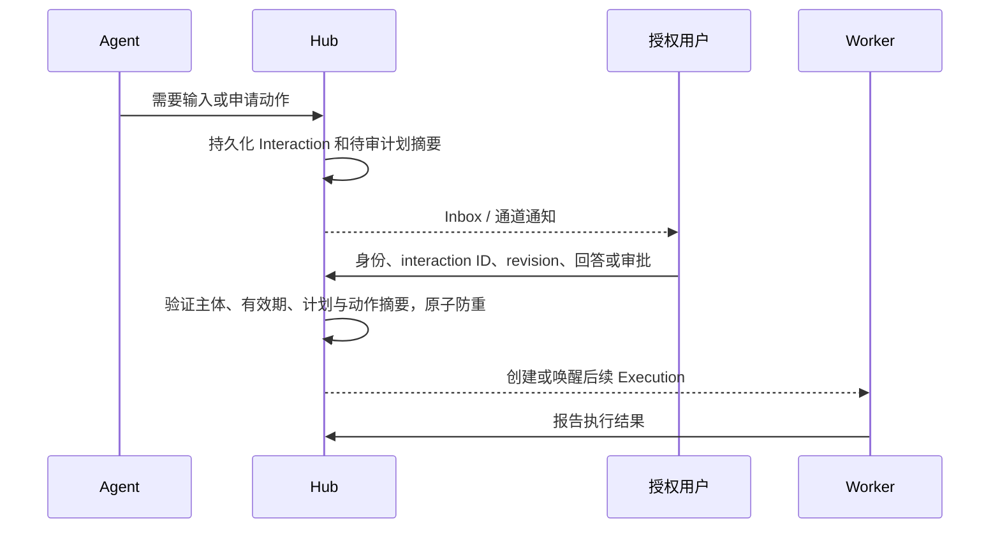

普通回答与高风险审批分开。审批绑定 `policyHash + planRevision + actionDigest + workspaceDigest + expiry + idempotencyKey`；任一关键输入变化须重新审批。回答使用客户端幂等 ID 和版本比较：相同回答重复提交返回原结果，不同并发回答冲突；到期、拒绝、撤回和关闭均有可追溯状态。当前 loopback API 没有这套身份体系，不得把它描述为已实现授权。

## 6. 崩溃、租约与未知结果

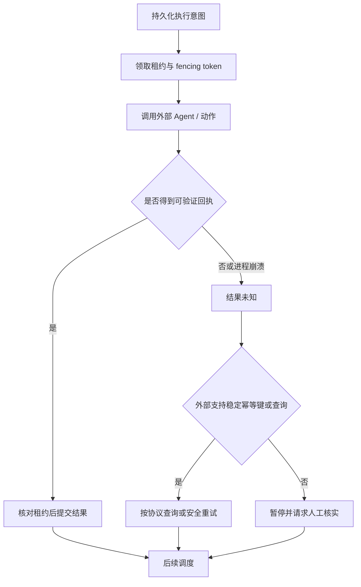

租约和 fencing 防止过期 Worker 提交状态，不能撤销它已经发出的外部请求。尤其在“外部已成功、回执未持久化”时，不能把 unknown 当作 failed 后盲目重试。可重试前提是目标系统明确支持同一动作键幂等，或已查询确认未发生；否则暂停。Agent 会话恢复也不证明先前工具调用没有副作用。

测试应覆盖事务前、事务提交后分发前、外部调用前、外部成功后保存前、提交完成后重复回执这五类崩溃点。恢复必须保存旧结果、避免过期租约覆盖，且未知状态可查询、可人工处置。v0.1.1 已有到期租约重领逻辑；以上更严格语义属于拟议变更，不能倒写成当前行为。

## 7. 插件与权限

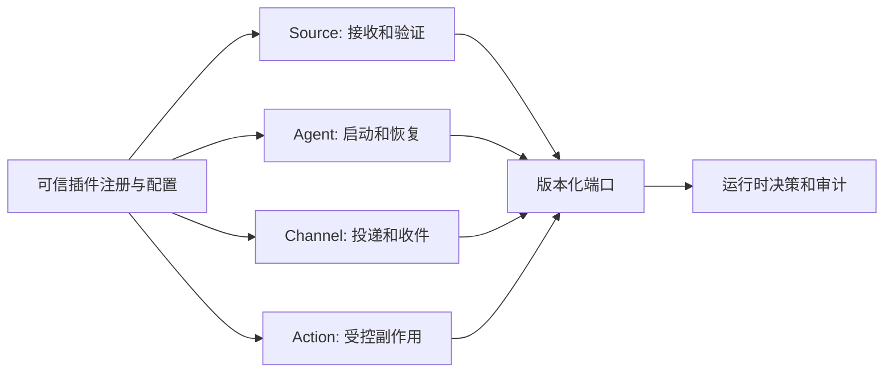

| 接口    | 输入和输出                            | 权限及失败约定                                             |
| ------- | ------------------------------------- | ---------------------------------------------------------- |
| Source  | 原始请求 → 已验证来源与标准事件       | 注册来源作用域、密钥和事件类型；验签失败不进入路由         |
| Agent   | 执行快照、会话、允许能力 → 结构化结果 | 声明恢复、取消、用量能力；未知能力不推断                   |
| Channel | 通知或交互 → 投递回执                 | 重复投递可能发生；平台消息 ID 和用户身份可验证时才接收回答 |
| Action  | 审批后的动作意图 → 回执或 unknown     | 允许列表、目标范围、幂等键、审计；不得从事件正文获取权限   |

首阶段可在进程内实现接口便利性，但插件与运行时共享用户权限，声明只是约定，不能阻止恶意插件。后续隔离需独立进程和操作系统强制执行的文件、网络、凭据、进程边界；不同平台逐项证明，失败时拒绝声称隔离，不静默降级。插件版本、配置来源、可信发布者、撤销与升级兼容均需制度和实现；不把未来插件目录当成可信软件供应链。

## 8. 接口草案

以下第一轮简化草案供历史对照；第二轮以第 18 节的版本化接口为准。均不是现有 TypeScript API：

```ts
type VerifiedEnvelope = {
  sourceInstanceId: string; // assigned by trusted ingress
  deliveryId: string;
  type: string;
  payload: unknown; // data, never an authority grant
  payloadHash: string;
  receivedAt: string;
};
type Decision = {
  policyVersion: string;
  action: "ignore" | "create" | "attach" | "queue" | "wait" | "stop";
  workItemId?: string;
  reason: string;
};
interface PolicyEngine {
  decide(
    input: VerifiedEnvelope,
    state: Readonly<unknown>,
    context: Readonly<unknown>,
  ): Decision;
}
interface AgentAdapter {
  execute(input: Readonly<unknown>): Promise<unknown>;
  resume?(input: Readonly<unknown>): Promise<unknown>;
}
```

实际协议需要定义结果联合类型、来源凭据、取消、故障分类、版本协商、超时与向后兼容；`unknown` 在这里表示待设计而非允许未经验证地运行。

## 9. 运维与观察

查询按 Work Item 展示事件、关联理由、策略版本、执行、会话、人工交互、预算、外部动作及其 unknown 状态；SSE 可断线重连，但不能假设有限保留的 feed 永不丢失，应通过游标缺口回退快照。日志避免事件正文、凭据和会话 ID 默认泄漏；数据保留、访问控制、备份恢复分别定义。Windows 任务计划与 Job Object 只提供进程管理；目前没有在本轮验证真实 reboot/logon。

## 10. 路由配置示例与 Agent 能力

以下仅为建议的声明式配置，不是现有可用语法。管理员将 `workspace`、指令模板和凭据引用映射到受控注册表；`subject` 只用于可信解析器限定的业务关联，不可作为任意路径。

```yaml
version: 1
sources:
  issue-source:
    adapter: github
    credential: github-webhook-secret
rules:
  - id: triage-issue
    when: { source: issue-source, type: issue.opened }
    correlation: { resolver: github-issue, scope: repository }
    action: { agent: codex, workspace: backend, instruction: issue-triage }
    execution: { resume: true, max_attempts: 3 }
    feedback: { allowed_types: [task.followup], max_depth: 4 }
    approval: { required_for: [external_write, destructive_action] }
    budget: { max_executions: 8, max_elapsed_minutes: 180 }
```

匹配优先级、无匹配事件、规则冲突均应显式定义：按优先级与稳定 ID 确定顺序；相同优先级存在不可消歧的动作则拒绝并记录，不由外部事件选择。策略固定于每次决策和已领取执行，重新排队是否采用新策略由兼容规则明确；策略变更不得追认已经发出的动作。Cron、CLI 和未来文件监听也应转换为内部受信来源，文件变化并不自动获得更高权限。

Agent 能力清单建议包含 `sessionResume`、`streaming`、`cancellation`、`structuredOutput`、`permissionRequests`、`usageReporting`，每项有协议版本、是否可验证和限制；未知视为不支持。声明必须由适配器契约测试和真实版本兼容矩阵验证，不能凭声明保证取消已经停止子进程。分类统一为 complete、ask、later、retry、emit、failure、unknown；每次结果可有多个候选，但状态转换与顺序由可信策略确定，complete 仅在完成条件核实后关闭长期工作项。

## 11. 插件生命周期、隔离和内核职责

注册表由管理员配置插件标识、接口版本、可用能力、来源作用域及凭据引用；启动时校验配置、协商能力，执行时分配有界请求，关闭时取消并回收进程，崩溃时记录失败或 unknown 并按策略恢复。Source、Agent、Channel、Action 与拟议 Execution Backend 均不直接决定核心状态；纯内存 Mock 实现可让核心不依赖外部插件运行。Policy 先使用内置声明式引擎；若以后允许第三方 policy 插件，它只能提出建议，最终授权仍在内核执行。

Execution Backend 描述进程启动、取消、资源和隔离能力；本地进程是基线，容器/VM 是以后单独实现和测试的后端。接口要求不得给予插件数据库句柄，只能通过版本化受限 API 提交结果；但同用户同进程或未隔离子进程仍可能直接访问数据库文件，必须依靠 OS 隔离、单独身份或其他强制机制才能真正禁止。插件超时、异常与恶意行为分别处理；通道失败不撤销已经提交的工作状态，外部投递用 Outbox 重试并接受至少一次投递。

## 12. 崩溃恢复时序

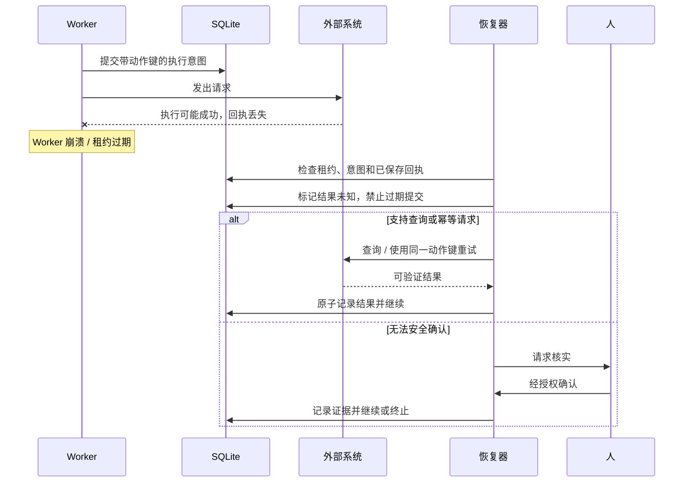

## 13. 第二轮工程决策：Definition、Root 与工作项

本节及第 14–20 节是第二轮提案，细化并在冲突时取代前述第一轮简化方案；均未实现。

| 模型                   | 身份与主要字段                                                                            | 生命周期与约束                                                                                 |
| ---------------------- | ----------------------------------------------------------------------------------------- | ---------------------------------------------------------------------------------------------- |
| AutomationDefinition   | id、revision、enabled、trigger、policy_snapshot_ref、root_template                        | 长期定义及不可变版本；禁用只阻止新 Root，不隐式取消现存 Root                                   |
| AutomationRoot         | id、definition_id、definition_revision、trigger_key、state、created_at、deadline、version | 一次有界闭环；每次触发至多一个 Root；终态不可重新激活                                          |
| WorkItem               | id、root_id、correlation_scope、subject_key、generation、state、version                   | 恰属一个 Root，同一 Root 可有多个工作项                                                        |
| Event / EventRoot      | 事件唯一身份、来源和摘要；EventRoot 保存 event_id、root_id、匹配决策                      | 一个外部事件可按可信规则关联多个 Root，但每个 Root 独立判断与计费；子事件只能继承产生它的 Root |
| RootBudget             | root_id、各维上限、已用、已预留、未知消耗、version                                        | 与 Root 一对一；Root 下工作项竞争同一账本                                                      |
| Decision / Interaction | root_id、work_item_id、execution_id、策略版本和因果来源                                   | 与 Root 绑定；事件不一定产生工作项                                                             |

**取舍与关系**：长期的“每天检查三个仓库”是 Definition；每个已去重的每日触发形成一个 Root，三个仓库分别形成 Work Item。Definition 为无周期的一次性运行提供可由系统创建的内置单次定义版本，不要求用户手工先建 Definition。一个 Work Item 不同时属于多个 Root：若同一业务对象跨循环出现，在新 Root 创建新 Work Item，并可保存只读 `predecessor_work_item_id` 作追溯，不共享状态、会话或预算。原因是跨 Root 共用会使审批、取消、预算和终态归属不确定。

Definition、Root、WorkItem 必须分别存在；不是为每一轮 Execution 再建 Root。Root 唯一键为 `(definition_id, definition_revision, trigger_key)`，定时触发键包含计划 ID 和规范化 UTC 计划时刻；相同业务定义在升级版本时防重边界需由迁移明确，不能把同一已经接收的触发重新执行。外部事件关联 Root 的身份由服务端可信策略决定，外部传入的 root ID 仅是候选，须授权并与规则一致。EventRoot 和 EventWorkItem 同事务登记，后者只能关联该 Root 所有的工作项。

**关联键**：采用已验证来源实例、可信仓库稳定 ID、对象类型和对象稳定 ID 的规范化元组，再附 Definition 和 Root 作用域；不能仅凭仓库名、URL 文字或 issue 编号。解析不出可靠 ID 时进入待核实或拒绝关联，不自动合并。运行中事件追加到下一代输入快照；不能改变已领取执行的输入或审批。

**Root 状态**：`active → waiting → active`；全部工作项完成、无未处理事件/定时任务/待审动作时由事务判定 `completed`；显式取消为 `cancelled`；不可恢复故障或策略要求全部成功而有永久失败为 `failed`；预算耗尽或 unknown 为 `waiting` 并保存原因，非隐式完成。终态不可回退，新事件由 Definition 触发新 Root。默认工作项隔离失败：A 失败不取消 B/C；Root 可在所有项终态后按 Definition 的 `all_succeeded` 或 `allow_partial` 汇总，默认 `all_succeeded`。同一事务内核对 root 版本、所有项、未分发 Outbox 和有效调度，避免完成与新事件并发。

**旧库兼容方案**：当前工作项无 Root。迁移可为每个历史 Work Item 建一个 `origin=legacy`、单项 Root 和系统内置 legacy Definition，保留原工作项、执行、会话、状态与 ID；旧事件缺乏可证明关联时不虚构。历史用量不明标记 unknown，不能据此声称过去受预算约束；未结束旧任务先走 v0.1.1 兼容执行路径，显式选择采用新策略并完成预算初始化后才纳入新循环。迁移需要备份、幂等校验、中断续跑和恢复演练，兼容双读方案及何时禁止旧版本写入须实现前确认。

## 14. 四套状态机：原则与持久化

表内每一行都是唯一合法迁移；没有列出的迁移一律拒绝。写入状态、版本、原因、Decision 和后续意图必须处于同一 SQLite 写事务；外部 IO 不在事务内。所有命令带幂等键和预期版本，状态与版本条件更新成功才生效；重放相同命令返回原结果，键相同但请求摘要不同返回冲突。终态不可直接改写；恢复通过表中明确的重新入队命令或创建新对象完成。

### 14.1 Event / Delivery 状态机

状态属于每次 DeliveryAttempt；canonical Event 不会因重复投递被改成 deduplicated。收到尚未认证数据先受大小与速率限制；拒绝时仅留必要的安全元数据，不得将无效身份当有效来源。processed 表示已产生且提交路由决策，不表示工作已完成。

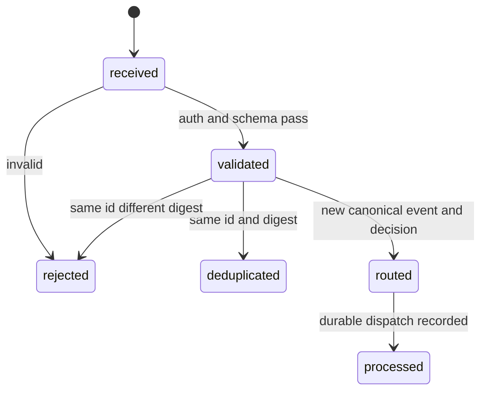

| 从 → 到                  | 触发与条件                              | 持久化及恢复                                    |
| ------------------------ | --------------------------------------- | ----------------------------------------------- |
| received → validated     | 验证来源、schema、类型与可信作用域      | 写身份引用及摘要，不持有凭据；崩溃后可重验      |
| received → rejected      | 校验失败                                | 保存有限拒绝原因；不路由                        |
| validated → deduplicated | 来源实例 + delivery ID 已存在且摘要相同 | 引用 canonical Event 和原结果，不创建执行       |
| validated → rejected     | 相同 ID 但摘要不同                      | 保存冲突审计，不覆盖首条事件                    |
| validated → routed       | 新事件，路由决定忽略、挂接或创建        | 唯一键、Event、Root 关联、Decision 和意图同事务 |
| routed → processed       | 已登记所有路由/入队意图，含明确忽略     | 事务确认；重复恢复只读已有意图                  |

`rejected/deduplicated/processed` 为终态；不能将重复投递重新路由。唯一索引 `(source_instance_id, delivery_id)` 是并发判据，多个入口竞争时败者回读摘要；只有已认证来源才能进入该去重域。崩溃在提交前全部回滚，提交后根据状态和同一幂等键重试；Outbox 投递另行追踪。

### 14.2 Work Item 状态机

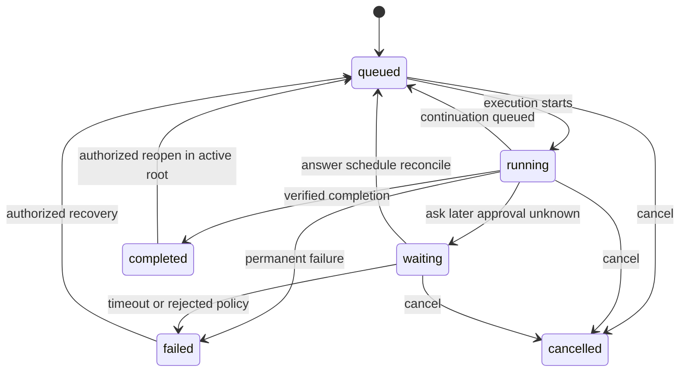

| 从 → 到                                | 触发与条件                                                    | 持久化及联动                                                       |
| -------------------------------------- | ------------------------------------------------------------- | ------------------------------------------------------------------ |
| 初建 → queued                          | 已关联 Root 且有待处理输入                                    | 创建工作项、首个执行意图与决策                                     |
| queued → running                       | 唯一执行领取后确认启动                                        | 工作项和执行版本共同校验                                           |
| running → queued                       | 未完成且安全的继续/重试已安排                                 | 执行结束、下轮意图和预算预留原子写入                               |
| running → waiting                      | Ask、Approval、Later 或 unknown                               | 创建 Interaction/定时计划/核实请求，Agent 进程结束                 |
| running → completed                    | 有完成证据、无未处理输入、未解决交互或未确认动作              | 完成决策及版本、证据引用一同提交                                   |
| running / waiting → failed             | 经分类永久失败或到期策略终止                                  | 记录原因；默认不取消同 Root 其他项                                 |
| queued / running / waiting → cancelled | 已授权取消                                                    | 停止新的派发；在途外部动作仍需核实                                 |
| waiting → queued                       | 有效回答、审批、到期计划或 unknown 已核实，且 Root 和预算允许 | 创建唯一续执行；重验策略和审批摘要                                 |
| failed → queued                        | 授权人显式恢复，Root 仍 active，条件已改变                    | 保存恢复决策，不覆盖历史执行                                       |
| completed → queued                     | Root 未终止，可信策略明确允许重开，新的非重复事件到达         | generation 加一，保留完成历史；Root 已终态则创建新 Root 和新工作项 |

运行中新事件只追加下一批；等待审批时先持久化事件，若影响计划、工作区、权限或动作摘要，原审批失效并重新申请，否则不改原待审快照。完成与新事件、取消、回答竞争时，按同一事务版本条件仲裁；已完成 Root 不重开。除明确恢复外终态禁止跳到 running；崩溃后依据已提交执行和交互重建可派发工作，不根据最后 UI 状态猜测。

### 14.3 Execution 状态机

一次 Execution 是一次运行尝试；重试、回答和 Later 均创建新 Execution，保留父子关系。waiting 与 retry_scheduled 是当前执行的终态，后续创建新对象；unknown 是阻塞态。新模型必须与旧状态兼容映射，不能原地把历史状态改称已成功。

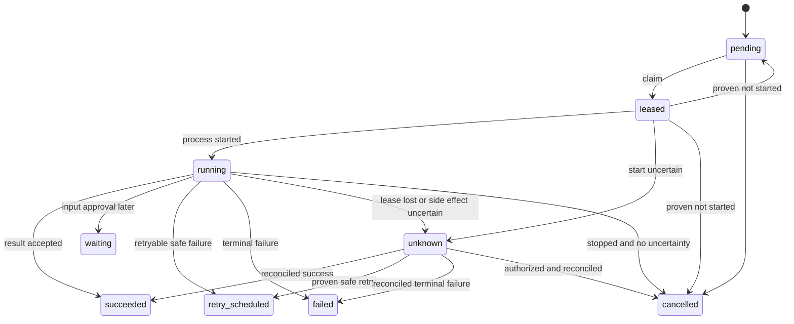

| 从 → 到                                          | 条件                                                   | 同事务副作用                                                |
| ------------------------------------------------ | ------------------------------------------------------ | ----------------------------------------------------------- |
| 初建 → pending                                   | 可信决策创建                                           | `(work_item_id, trigger_key)` 唯一；预留预算                |
| pending → leased                                 | 领取到期工作且 Root 允许                               | 单调 lease_epoch + 随机 token、owner、到期时间              |
| leased → running                                 | 进程启动证据已登记                                     | 记录启动时间；心跳只延长有效租约，不更改状态                |
| leased → pending                                 | 可证明外部进程和动作均未启动                           | 释放或复用同一预留；否则 unknown                            |
| leased / running → unknown                       | 启动不确定、租约到期、进程崩溃或动作回执不明           | 废止旧租约，冻结相关预留，暂停关联工作项                    |
| running → succeeded                              | 有有效租约、去重结果和策略核实的结果                   | 保存结果、预算结算、后续 Decision；不自动等于 WorkItem 完成 |
| running → waiting                                | Ask、审批或 Later 被允许                               | 保存交互/计划并释放租约；后续新 Execution                   |
| running / unknown → retry_scheduled              | 已知安全失败，或核实未发生、目标支持同键幂等且许可重试 | 旧执行终止、重试计划和唯一新触发意图原子登记                |
| running / unknown → failed                       | 已证实不可恢复、核实后的永久失败                       | 记录错误与证据；WorkItem 按策略失败                         |
| pending / leased / running / unknown → cancelled | 已授权，且对可能发生的副作用已核实；pending 不需核实   | 记录取消；不能把在途未知动作伪装为已取消                    |
| unknown → succeeded                              | 外部回执或可靠查询证实                                 | 保存证据、结算后再决定工作项状态                            |

`succeeded/waiting/retry_scheduled/failed/cancelled` 不能直接回到 running；unknown 不能仅因超时变为 pending。对同一 Work Item，建议部分唯一索引限制 `pending/leased/running/unknown` 中至多一个；合并后续输入，避免并发生成多个活动 Execution。Worker 结果和心跳均须 `execution_id + owner + lease_epoch + token + lease_until > now` 条件匹配；epoch 递增不能替代外部系统支持 fencing。若结果已提交，重复相同结果返回记录；不同摘要冲突。恢复器对过期租约使用版本比较写入 unknown，不能抢走仍有效租约。v0.1.1 当前行为是到期直接重领，不是这个设计。

### 14.4 Interaction / Approval 状态机

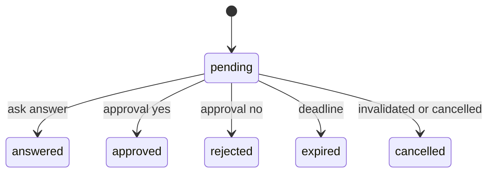

| 从 → 到             | 条件                                            | 持久化及联动                                                                            |
| ------------------- | ----------------------------------------------- | --------------------------------------------------------------------------------------- |
| 创建 → pending      | 执行被允许提出 Ask 或 Approval                  | kind、授权主体、版本、到期时间、请求摘要和通知意图同事务                                |
| pending → answered  | kind=ask，回答者已认证授权且符合选项            | 保存回答 ID、摘要和主体，唯一创建恢复意图                                               |
| pending → approved  | kind=approval，主体可审批，摘要及策略版本仍一致 | 绑定主体、actionDigest、planRevision、workspaceDigest、policyHash、expiry 与 action key |
| pending → rejected  | kind=approval 且有权拒绝                        | 审计拒绝；按策略等待人工/结束                                                           |
| pending → expired   | 当前时间到期且仍 pending                        | 原子 CAS，记录时间；按策略等待、失败或重新提问                                          |
| pending → cancelled | 根/工作项取消，或审批绑定项变化                 | 记录原因；必要时新建独立审批                                                            |

普通 Ask 不能进入 approved/rejected；Approval 不能由普通文本回答绕过授权。终态不能重新打开，需新 Interaction；重复相同提交返回结果，不同主体或不同答案并发竞争时只有一个 CAS 成功。审批结果和计划/工作区变更必须在同一锁域重验；批准到外部派发间再次检查摘要及未过期。崩溃后已决交互的恢复意图应以唯一键安全重放；通知失败不改变交互状态。通知接收身份必须通过渠道认证，当前 v0.1.1 loopback 不提供此能力。

**跨状态机联动**：routed 事件只创建队列意图；领取使执行 leased/running 并带动工作项 running；执行 waiting 时工作项 waiting；有效交互或定时触发创建新 pending 执行；Work Item 完成后才检查 Root 汇总。交互/通知和 Agent 进程结束相互独立。所有并发取舍通过同事务的版本和唯一索引确定，而不是最后写入者获胜。

## 15. Feedback Loop：建议不等于授权

Agent 只提交结构化结果及下一步建议，Classifier 负责 schema、来源、格式与确定性分类；不能授权或写状态。Policy Engine 只读取可信版本的规则、已验证上下文、Root/WorkItem 版本、预算、已批准动作与外部回执，输出允许或拒绝的 Decision。未经核实的 Agent 自评完成不能单独决定 Root 完成。

```ts
type AgentError = { code: string; message: string; retryable: boolean };
type ProposedAction = {
  kind: string;
  targetRef: string;
  payload: unknown;
  actionKey: string;
};
type EventProposal = { type: string; subject: string; payload: unknown };
type AgentResult =
  | { type: "completed"; summary: string; evidenceRefs: string[] }
  | { type: "continue"; reason: string; input: unknown }
  | { type: "needs_input"; question: string; options: string[] }
  | { type: "needs_approval"; action: ProposedAction; planRevision: string }
  | { type: "later"; resumeAt: string; reason: string }
  | { type: "failed"; error: AgentError }
  | { type: "emit_event"; event: EventProposal }
  | { type: "proposed_action"; action: ProposedAction; planRevision: string }
  | { type: "unknown"; reason: string; evidenceRefs: string[] }
  | { type: "stop"; reason: string };
```

结果联合类型每次表达一个主要建议；多个行动由后续执行或受控计划明示，不能以可选字段隐式混合完成与副作用。上游可同时记录标准 session 元数据，但 session 标识及证据是声明，必须校验。结果版本需单独指定；v0.1.1 的 `completed/needs_input/later/failed` 通过兼容适配转换，输出类型和现有 API 不因草案自动改变。

| 决策       | 必要条件                                                               | 同事务写入                                                    |
| ---------- | ---------------------------------------------------------------------- | ------------------------------------------------------------- |
| Complete   | 指定的可信完成条件及证据通过；无未处理事件、待审批、未决动作或后续计划 | 当前执行结果、工作项完成及 Root 汇总检查                      |
| Continue   | Root 有效、可信策略允许且预算预留成功                                  | 新执行、稳定 trigger key、输入快照                            |
| Ask        | 输入类型允许且需要人                                                   | pending Ask、通知 Outbox、工作项 waiting                      |
| Approve    | 高风险动作通过前置权限校验但需要审批                                   | pending Approval 和动作摘要；尚不发送动作                     |
| Later      | 时间在允许范围内、Root 未过期                                          | 唯一 schedule，工作项 waiting                                 |
| Retry      | 错误被判可重试且外部副作用已知安全                                     | 旧执行 retry_scheduled、重试 schedule；新执行在计划触发时创建 |
| Emit Event | 类型、来源、目标作用域、深度及预算全部允许                             | 子事件、继承 root_id/parent_id、Decision 和路由意图           |
| Unknown    | 无法判断动作或用量                                                     | 冻结相关预留，工作项 waiting，创建核实事项                    |
| Stop       | 策略拒绝、循环熔断、用户取消或预算耗尽                                 | 原因及可恢复性；暂停或终止按规则区分                          |

提交流程：验证租约和结果幂等键 → 解析结果 → 读取固定策略快照与工作项输入版本 → 验证 Root 状态、预算、深度、执行次数、截止时间和权限 → 对拟议动作执行审批策略 → 同事务写结果、Decision、预算预留和唯一后继意图 → 提交后再发出外部动作。人工回答由 Interaction 关联原 Root、WorkItem 和 Session；恢复前重验预算、状态与策略，创建新执行。通过部分唯一索引和 `(work_item_id, trigger_key)` 唯一约束，两个 Worker 不能把同一结果创建为两个新执行。

## 16. Root Budget：预留、结算与熔断

每个 Root 一个账本，所有 Work Item 共用，子事件继承 Root 和已用额度；新的 Root 使用新预算但不能由旧 Root 任意生成以绕过上限。初始上限和管理员变更受可信系统/Definition 最大上限约束，Root 内不得由 Agent 或事件提高额度。

| 维度            | 扣减与边界                                                                                            |
| --------------- | ----------------------------------------------------------------------------------------------------- |
| Max Depth       | 首次事件深度 0，反馈子事件为父深度 + 1；拒绝超过最大深度，不累计成费用                                |
| Max Executions  | 每创建一个实际执行尝试预留 1，包括 retry、回答恢复和 Later 恢复；未启动且可证实撤销可释放，未知时冻结 |
| Max Duration    | 固定 wall-clock deadline = Root 创建时刻 + 允许时长；人工等待和 Later 均计入；重启不重置              |
| Max Agent Calls | 每次实际 Agent 启动前预留一次；包括同一次执行内部的恢复或协议重试；启动是否发生不明则冻结             |
| Max Tokens      | 请求前按提供方可执行的最大调用量预留；结束按可信用量结算，缺失则冻结并按策略停止                      |
| Max Cost        | 用保守价格和请求上限估算预留，按可信账单结算；价格变更或超额可能导致实际值超预算，不能称绝对财务上限  |

Later 等待不消耗执行次数或 Agent 次数，但 deadline 持续推进；触发后创建的执行才消耗。预算计算用非负整数：token 为整数，金额使用约定最小货币单位，避免浮点误差。多个币种和价格版本不能直接相加；必须指定币种、定价版本与换算来源。调用前没有可强制的 token 上限、可靠价格或可信用量时，该维度为 best-effort；如定义要求硬约束则不启动并要求人工配置/核实。实际提供方可超出估计，已发生的超额仍须记账并熔断。

**事务协议**：在 `BEGIN IMMEDIATE` 内读取 Root 与预算 version，验证 `used + reserved + requested <= limit`、deadline 和深度；以 `reservation_id=(root_id, execution_id, dimension, phase)` 唯一写预留，再写 Execution 与 Decision；更新预算 version 后提交。条件更新影响 0 行则回读并拒绝或重新计算，不能双花。外部调用后以 `(reservation_id, settlement_id)` 幂等结算：可信实际值转 used，剩余释放；收到不同重复结算进入冲突审计；实际值超预留如实记 used 并停止后续发放。崩溃或无法判断是否调用时预留转 unknown，不超时自动释放；查询、账单或人工授权核实后再结算/释放。

熔断先拒绝新增执行并将 Root 置 waiting，列出耗尽维度和可恢复条件；已在运行的调用能否取消取决于后端，不能保证即时停费。管理员在认证授权后可提交带原因、旧值、新值、操作者、时间及期望版本的调整；受系统上限限制并与预留串行化，已过 deadline 的 Root 不重新激活，另开新 Root。预算是否允许调整及上限应由部署策略决定。

## 17. 外部副作用：意图、Outbox 与核实

Fencing Token 只能让支持校验该令牌的服务拒绝过期写入；TaskCircuit 的 SQLite 会校验租约，但普通外部 API 不知道 epoch。因此外部成功后 Worker 崩溃、租约过期，新 Worker 若盲目再次请求仍可能执行两次。数据库提交、Agent 进程、外部 API 调用、外部实际成功与回执持久化是五个不同的事实。

```mermaid
sequenceDiagram
    participant W as Worker
    participant DB as SQLite
    participant O as Outbox Dispatcher
    participant X as External API
    participant R as Reconciler
    W->>DB: valid epoch + proposal
    DB->>DB: policy approval + ActionIntent + stable key + Outbox commit
    O->>DB: claim outbox with lease and epoch
    O->>X: request with stable idempotency key
    X->>X: external effect succeeds
    X--xO: reply lost / dispatcher crashes
    Note over DB: action outcome unknown; old lease expires
    R->>DB: CAS mark unknown; freeze reservation
    alt provider supports lookup
        R->>X: lookup by stable key
        X-->>R: verified receipt / authoritative not-found
    else provider guarantees idempotency within retention
        R->>X: retry identical request and same key
        X-->>R: original or new result
    else no safe proof
        R->>DB: persist manual reconciliation request
    end
    R->>DB: persist receipt/evidence and settlement atomically
```

ActionIntent 唯一键作用于 Root、目标系统、业务动作与计划 revision；保存规范化请求摘要、审批绑定、稳定外部幂等键、状态及策略版本。Outbox 将发送意图和业务决策同事务提交，但 dispatcher 自身至多提供至少一次尝试。ExternalReceipt 保存来源、响应摘要、外部 ID、校验方式、时间和证据引用；重复同一回执幂等，不同摘要冲突。

| 外部能力                   | 恢复策略与前提                                                                                 |
| -------------------------- | ---------------------------------------------------------------------------------------------- |
| 有明确幂等保证             | 同目标、同 key、同规范请求在提供方承诺的保留时间内安全重试；过期或内容变化不能沿用保证         |
| 可可靠查询                 | 先按动作键查询；仅权威且一致性窗口已过的“未发生”可作为重试依据；查询延迟或不完整时保持 unknown |
| 两者都无                   | 保持 unknown，暂停相关工作和预算，授权人工核实；不得盲重试                                     |
| Agent 自己直接调用外部工具 | 控制面可能看不到动作，更不能保证防重；须限制工具权限或采用受控执行/动作代理，无法核实时暂停    |

旧 Worker 过期后既不能提交数据库结果，也不能凭本地 token 重发；但无法撤销它已发出的请求。确认结果、动作状态、执行结果及预算结算同事务提交；无法获取可靠证据时允许带审计的人工作“已发生/未发生”判断，但不能把人工判断表述为系统证明。无跨系统恰好一次保证。

## 18. 版本化插件契约

下面是接口草案，不是可安装 SDK。核心只认识接口及版本化数据，不导入具体插件。类型只给出边界示例；在真实实现前须补齐序列化 schema、尺寸约束、版本协商和错误码。

```ts
type PluginKind =
  "source" | "agent" | "channel" | "action" | "execution-backend";
type PluginCapability =
  | "source.verify"
  | "source.events"
  | "agent.resume"
  | "agent.stream"
  | "agent.cancel"
  | "agent.structured-result"
  | "agent.permission-request"
  | "agent.usage"
  | "channel.notify"
  | "channel.receive-answer"
  | "action.invoke"
  | "action.lookup"
  | "action.idempotent"
  | "backend.spawn"
  | "backend.cancel"
  | "backend.isolation";
type PluginManifest = {
  id: string;
  kind: PluginKind;
  pluginVersion: string;
  contractVersion: "1";
  capabilities: readonly PluginCapability[];
};
type PluginContext = {
  instanceId: string;
  config: Readonly<Record<string, unknown>>;
  signal: AbortSignal;
  log: (record: { level: "info" | "warn" | "error"; code: string }) => void;
};
interface PluginLifecycle {
  start(context: PluginContext): Promise<void>;
  stop(reason: "shutdown" | "disabled" | "error"): Promise<void>;
}
type SourceRequest = {
  headers: Readonly<Record<string, string>>;
  body: Uint8Array;
};
type NormalizedEvent = {
  deliveryId: string;
  type: string;
  occurredAt: string | null;
  subject: string;
  payload: unknown;
};
interface SourceAdapter extends PluginLifecycle {
  verifyAndNormalize(request: SourceRequest): Promise<NormalizedEvent[]>;
}
type AgentInput = {
  rootId: string;
  workItemId: string;
  executionId: string;
  sessionRef: string | null;
  instructionRef: string;
  input: unknown;
};
interface AgentAdapter extends PluginLifecycle {
  execute(input: AgentInput, signal: AbortSignal): Promise<AgentResult>;
  resume?(input: AgentInput, signal: AbortSignal): Promise<AgentResult>;
}
type Delivery = { notificationId: string; body: unknown; deliveryKey: string };
type ChannelReceipt = { providerMessageId: string | null };
type AnswerInput = {
  messageId: string;
  authenticatedPrincipal: string;
  answer: unknown;
};
interface ChannelAdapter extends PluginLifecycle {
  send(input: Delivery, signal: AbortSignal): Promise<ChannelReceipt>;
  verifyAnswer?(input: unknown): Promise<AnswerInput>;
}
type ActionRequest = {
  actionId: string;
  targetRef: string;
  idempotencyKey: string;
  requestDigest: string;
  payload: unknown;
};
type ActionOutcome =
  | { type: "confirmed"; receipt: string }
  | { type: "rejected"; reason: string }
  | { type: "unknown"; reason: string };
interface ActionAdapter extends PluginLifecycle {
  invoke(input: ActionRequest, signal: AbortSignal): Promise<ActionOutcome>;
  lookup?(actionId: string, signal: AbortSignal): Promise<ActionOutcome>;
}
type SpawnSpec = {
  executableRef: string;
  workspaceRef: string;
  isolationProfileRef: string;
  resourceLimits: Readonly<Record<string, number>>;
};
type ProcessHandle = { id: string };
interface ExecutionBackend extends PluginLifecycle {
  spawn(spec: SpawnSpec, signal: AbortSignal): Promise<ProcessHandle>;
  cancel(handle: ProcessHandle): Promise<void>;
  wait(
    handle: ProcessHandle,
  ): Promise<{ exitCode: number | null; unknown: boolean }>;
}
```

接口约束：Host 按可信注册表和已验证凭据赋予 sourceInstanceId；插件返回的正文不能自报身份。Agent 的 `instructionRef` 和 `workspaceRef` 由可信配置解析；请求和返回值均须运行时验证。Channel 的回答主体须由渠道身份验证结果和本地授权映射共同确认，插件自报字符串不足以构成认证证明。Action 必须在审批和策略通过后才可调用；`actionKey` 是建议，最终键由内核确定。Backend 的 `isolationProfileRef` 由受信配置解析，能力声明经平台探测和测试，不接受仅靠插件声称。

| 插件              | 边界 / 最小权限                                    | 故障后的处理                                           |
| ----------------- | -------------------------------------------------- | ------------------------------------------------------ |
| Source            | 验证本实例来源并归一化；不选 Agent 或工作目录      | 验证失败拒绝，超时不写已处理，按来源协议重投           |
| Agent             | 使用已授予资源运行推理并提出结果；无法直接改变状态 | 超时或中断依副作用证据标 failed 或 unknown             |
| Channel           | 发送通知和校验回答；不能授权外部动作               | 通知 Outbox 重试，不能把发送失败变成业务执行失败       |
| Action            | 在受控授权后访问指定外部目标；返回外部回执         | 未知响应冻结并核实，不盲目重放                         |
| Execution Backend | 启动、停止及证明执行环境；不负责业务判断           | 清理失败时标 unknown；无法证明隔离则拒绝需要隔离的操作 |

生命周期：可信注册 → 清单和契约版本校验 → 按实例创建受限上下文 → start → 调用及超时/取消 → stop → 回收。未声明能力按不支持处理；插件异常只能形成可校验结果/错误，不得在核心事务中运行。调用端持有数据库事务和权限，插件仅获得不可变请求及受限回调，不获得数据库对象；但这只是接口约束，同进程插件和同用户未隔离进程仍可直接访问文件。真正禁止访问数据库、凭据和网络需独立进程、独立身份/权限及 OS 强制约束，并有平台验证；未达到时只适用于可信插件。

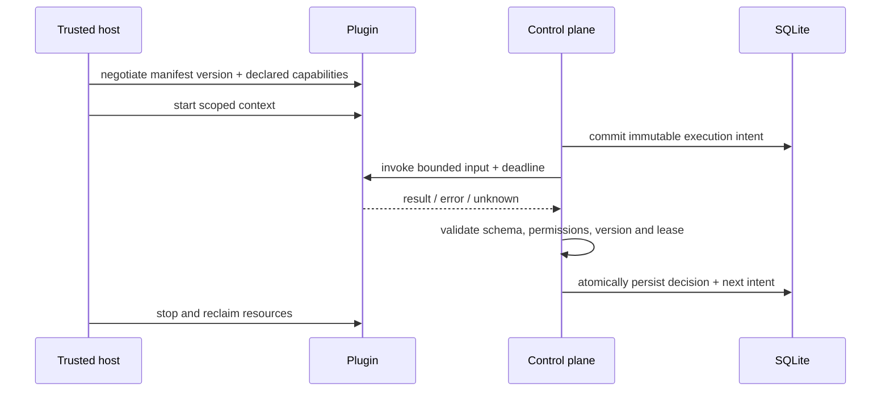

## 19. 关键约束、旧状态映射和实现拆分

| v0.1.1 现状                                    | 新模型中的兼容解释                                                                                    |
| ---------------------------------------------- | ----------------------------------------------------------------------------------------------------- |
| WorkItem `active`                              | 需根据执行、计划和交互事实推导 queued/running；事实不足标记 legacy，不盲映射                          |
| WorkItem `waiting_input/waiting_schedule`      | waiting，分别保存 interaction/schedule 原因                                                           |
| Execution `queued/claimed/running`             | 仅在升级切换时无在途 Worker 的前提下映射 pending/leased/running；运行中未核实的租约不自动视为安全重试 |
| Execution `waiting_input/retry_wait/completed` | waiting/retry_scheduled/succeeded 的兼容视图，保留原字段和原始值；历史完成不代表已做新完成条件验证    |
| Interaction `open/resolved/cancelled`          | pending/answered/cancelled；旧回答不推断授权审批身份                                                  |
| 唯一 `agent_sessions.work_item_id`             | 首阶段维持该约束，未来多 session 是另一个兼容变更                                                     |
| `schedule_firings(schedule_id, scheduled_for)` | 保留现有去重；新 Root 触发键复用可验证的计划时刻，不重复生成                                          |

迁移期间先停用新旧混合写入，通过维护窗口停止 Worker 并备份，再在事务内迁移；大库迁移须明确分批一致性与中断恢复方案。迁移完成前不能让旧进程继续领取；回滚依赖恢复迁移前备份，恢复会丢弃备份后的写入，故需停写和显式演练，不能声称无损回滚。实际发布前必须验证所有状态、定时任务、session、未完成问答及未知外部动作，不自动重放或重新调用 Agent。

拟拆分工程任务：① Schema 和旧库迁移及快照测试；② Delivery 幂等与 Root 创建；③ 关联、锁和 WorkItem 状态；④ 租约和 unknown；⑤ 预算事务；⑥ 结果分类和策略决策；⑦ 人工交互及审批；⑧ Outbox/动作核实；⑨ 观察与回放测试；⑩ 插件契约。每项先指定不变量和测试，再实现；当前文档不授权运行迁移或开发。

## 20. 仍需评审的选择

- 预算默认值及有限 deadline 是否适合长时间人工等待；是否需显式批准重开新 Root。
- 工作项完成重开与新 Root 的边界、跨 Root 只读前驱链接的保留期限。
- 来源身份、可信业务 ID 解析和多规则重叠冲突的具体配置。
- Agent 直接使用外部工具时，哪些后端能强制关闭网络或只允许受控 Action。
- 各提供方幂等保留时间、查询一致性和用量可信程度如何纳入能力矩阵。
- v0.1.1 客户端面对新增状态的兼容策略、停写升级窗口和回滚数据损失窗口。

## 21. 目标控制面和可直接拆分的约束

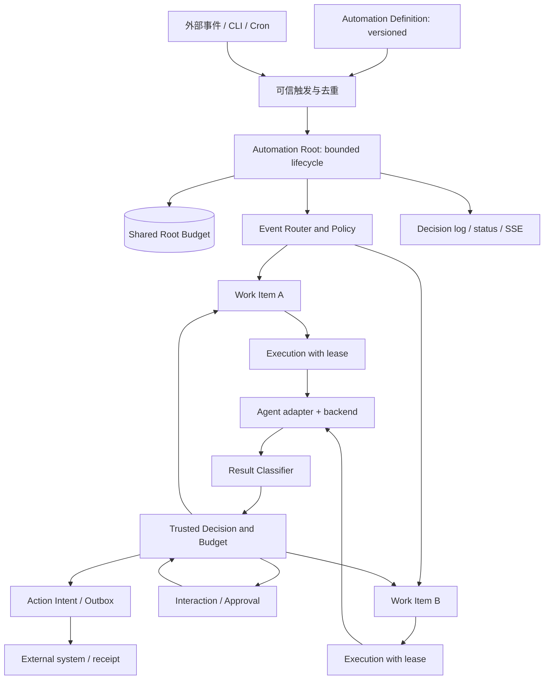

此图是目标设计；预算和授权由控制面执行，不是 Agent 自行执行。外部系统结果回流应先经认证、去重及关联再进入策略，图中简化展示。

| 持久约束                                                        | 实现前需要验证的行为                                                        |
| --------------------------------------------------------------- | --------------------------------------------------------------------------- |
| `UNIQUE(source_instance_id, delivery_id)`                       | 认证通过后写 canonical Event；重复摘要相等返回原结果，冲突不覆盖            |
| `UNIQUE(definition_id, definition_revision, trigger_key)`       | 同一触发不会并发产生两个 Root；定义升级时跨版本触发如何防重须在迁移方案约束 |
| `UNIQUE(root_id, correlation_scope, subject_key)`               | 同 Root 同可信对象只关联一个 WorkItem；generation 在原对象上递增            |
| `UNIQUE(event_id, root_id)` 和 `UNIQUE(event_id, work_item_id)` | Event 可多 Root；每个 EventWorkItem 必须同时存在对应 EventRoot              |
| `UNIQUE(work_item_id, trigger_key)`                             | 同一结果、回答或计划不能并发创建两个后续 Execution                          |
| 活动执行部分唯一索引，条件 `pending/leased/running/unknown`     | 每个工作项最多一个活动执行；等待中的输入进入下一批                          |
| `UNIQUE(root_id, execution_id, dimension, phase)`               | 同一预算预留可幂等；结算唯一且审计实际超额                                  |
| `UNIQUE(root_id, target, action_key)`                           | 同一目标的动作意图不能以相同键承载不同请求摘要                              |

业务规则跨表无法只依靠 SQLite 外键或上述索引表达，须由受控事务验证并配合并发测试；最终 Schema、精确索引和状态名须实现前评审。

**建议测试分解**：至少覆盖同键并发与不同摘要冲突、不同 Root 相同 subject 不合并、等待审批时计划变更、预算最后一份额度并发竞争、旧 Worker 过期回执、外部成功后回执丢失、outbox 重放、Unknown 的三种外部能力、历史旧库升级和中断恢复。每个用例断言持久状态、关联关系、唯一意图及副作用调用次数，不依赖 UI 文本；真实平台结果另行验证。
